# 04 - DIAGRAMS

[00 - START HERE](../00%20-%20START%20HERE/00%20-%20START%20HERE.md) · Previous: [03 - SYSTEM ARCHITECTURE](../03%20-%20SYSTEM%20ARCHITECTURE/03%20-%20SYSTEM%20ARCHITECTURE.md) · Next: [05 - ROADMAP](../05%20-%20ROADMAP/05%20-%20ROADMAP.md)

These are pictures of how the system works. Each one has a plain-language reading beneath it, so you never need to read a diagram to follow the notes.

- **Diagrams 1 to 6** show the **old system** as it works today.
- **Diagrams 7 to 9** show how things should move **according to the spec**.
- **Diagrams 10 to 12** show **the plan**.

Citation forms are the same as in [02 - FINDINGS](../02%20-%20FINDINGS/02%20-%20FINDINGS.md).

## 1. The big picture, old system

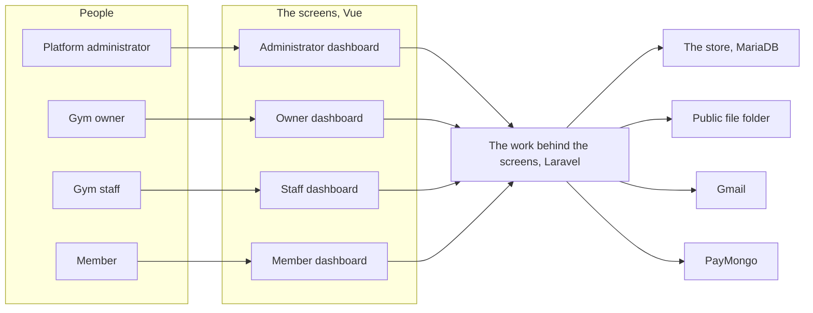

**Reading this:** Four kinds of people each have their own dashboard:

- administrators: `frontend/src/pages/AdminDashboard.vue`
- owners: `frontend/src/pages/TrainingDashboard.vue`
- staff: `frontend/src/pages/DynamicRoleDashboard.vue`
- members: `frontend/src/pages/MemberDashboard.vue`

All four dashboards send their requests to one Laravel backend. The backend keeps records in the MariaDB store and saves every upload in a folder anyone can reach by link. It also sends email through Gmail and takes online membership payments through PayMongo. This matches *The arrangement today* in [03 - SYSTEM ARCHITECTURE](../03%20-%20SYSTEM%20ARCHITECTURE/03%20-%20SYSTEM%20ARCHITECTURE.md).

## 2. Signing up and getting in, old system

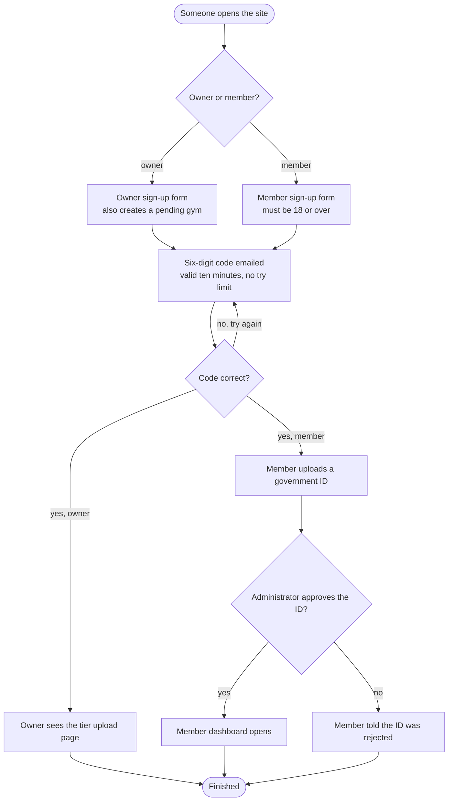

**Reading this:**

1. **Two separate doors.** Owners sign up on one page, and that step already creates their gym as "pending" (`backend/app/Http/Controllers/API/AuthController.php`, lines 50 to 125). Members sign up on another page, which checks they are 18 or over (`backend/app/Http/Controllers/API/MemberController.php`, lines 49 to 56).
2. **The emailed code.** Both get a code by email. It can be guessed again and again with no limit (`AuthController.php`, lines 130 to 224).
3. **After the code.** An owner goes to the tier upload page. A member must upload an ID and wait for the platform administrator (`MemberController.php`, lines 198 to 280; `backend/app/Http/Controllers/API/AdminController.php`, lines 181 to 246).

The spec has neither the two doors nor the ID wait: C-01 and C-02 in [02 - FINDINGS](../02%20-%20FINDINGS/02%20-%20FINDINGS.md).

## 3. A gym applies and is checked, old system

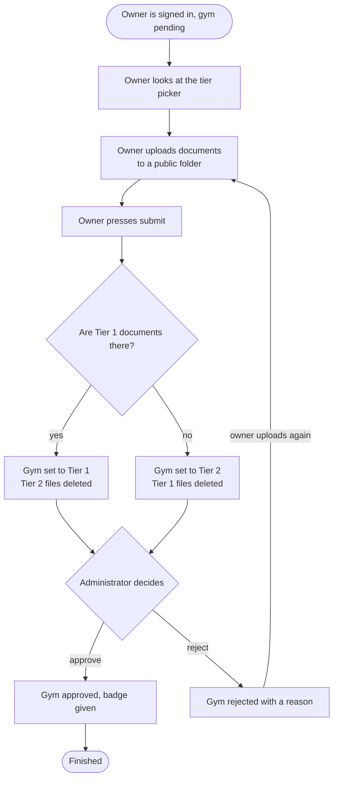

**Reading this:**

1. **Choosing a tier does nothing.** The owner sees a tier choice (`frontend/src/pages/Dashboard.vue`, lines 201 to 320), but the choice is never sent.
2. **The backend decides.** On submit, the backend picks the tier: Tier 1 wins if its documents exist. It then deletes the other tier's files (`backend/app/Models/TrainingCenter.php`, lines 248 to 259; `backend/app/Http/Controllers/API/DocumentController.php`, lines 246 to 277).
3. **The administrator has two choices.** Approve or reject (`backend/routes/api.php`, lines 568 to 584). A rejected owner can upload again. There is no "return for correction" and no checklist.

The spec version is diagram 7.

## 4. Joining a gym and paying, old system

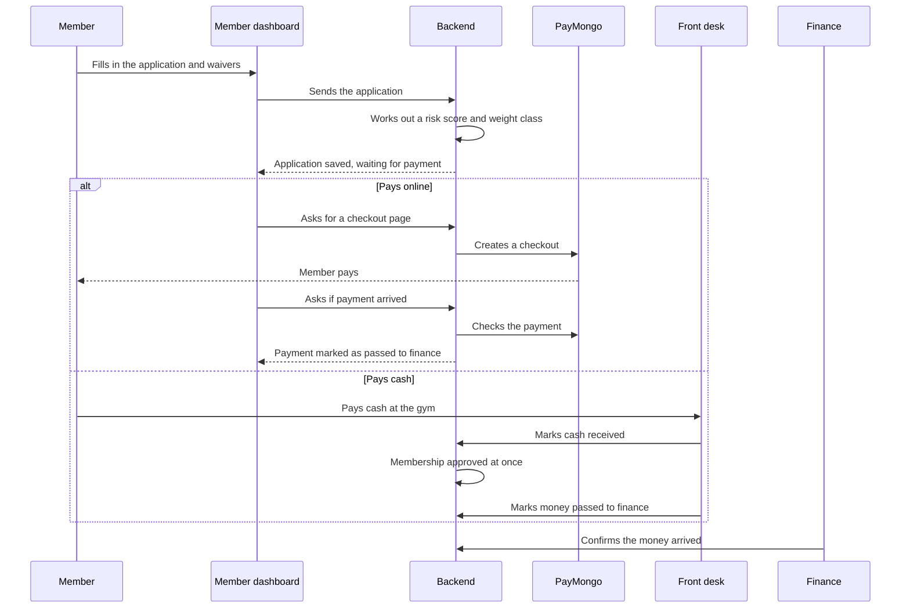

**Reading this:** Time runs downwards. Solid arrows are requests going out; dashed arrows are answers coming back.

1. **Applying.** The member sends an application. The backend adds a health "risk score" and a boxing weight class (`backend/app/Http/Controllers/API/MembershipApplicationController.php`, lines 148 to 155).
2. **Paying online.** The backend creates a PayMongo checkout. When the member comes back, the screen asks the backend to check with PayMongo (lines 301 to 461).
3. **Paying cash.** The front desk marks the cash received, and **that alone approves the membership**, before finance sees anything (`backend/app/Http/Controllers/API/MembershipPaymentController.php`, lines 78 to 85).
4. **Finance last.** Finance confirms at the end (lines 146 to 211).

No staff member ever decides whether the person should be a member. The spec says one must: C-13 in [02 - FINDINGS](../02%20-%20FINDINGS/02%20-%20FINDINGS.md).

## 5. Booking a session: the old way and the spec way

### 5a. The old way

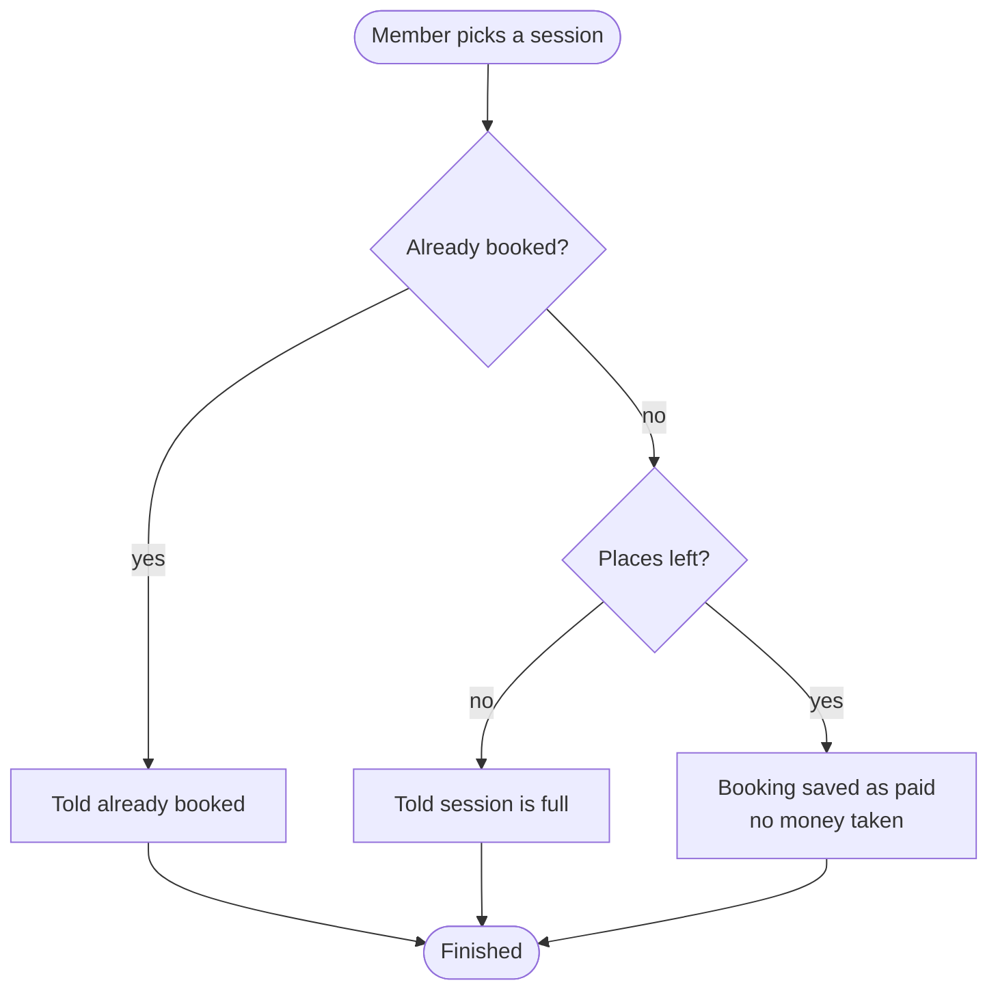

**Reading this:** The old booking checks only two things: whether the member already booked, and whether places are left. It then saves the booking as "paid" without taking any money (`backend/app/Http/Controllers/API/MemberTrainerSessionController.php`, lines 133 to 200).

### 5b. The spec way

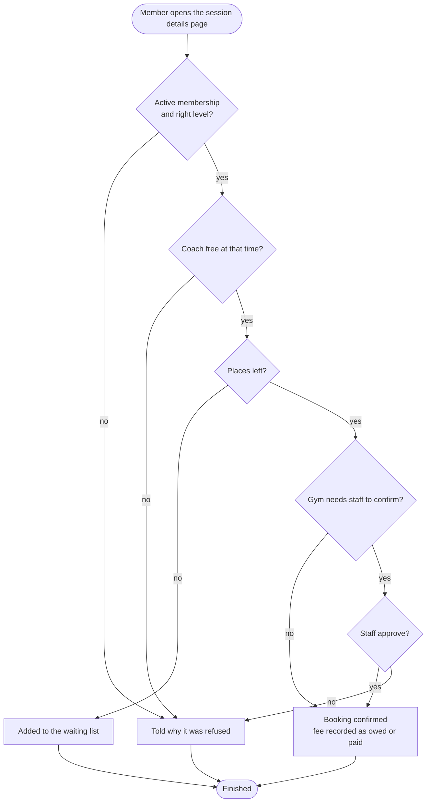

**Reading this:** The spec booking checks four things in turn:

1. **Details first.** The member sees the session's details first (the spec, pages 13 and 14).
2. **Eligibility.** They must have an active membership at the right level.
3. **The coach.** The coach must be free (the spec, page 13).
4. **Places.** If the session is full, they join the waiting list (the spec, page 13).

If the gym requires it, a staff member approves (the spec, page 14). Each outcome sends the athlete a notice: approved, rejected or waitlisted (the spec, page 18). "Fee recorded as owed or paid" is *drawn from* the spec, page 16 (session payments are income), and from C-09.

## 6. Payroll approval, old system

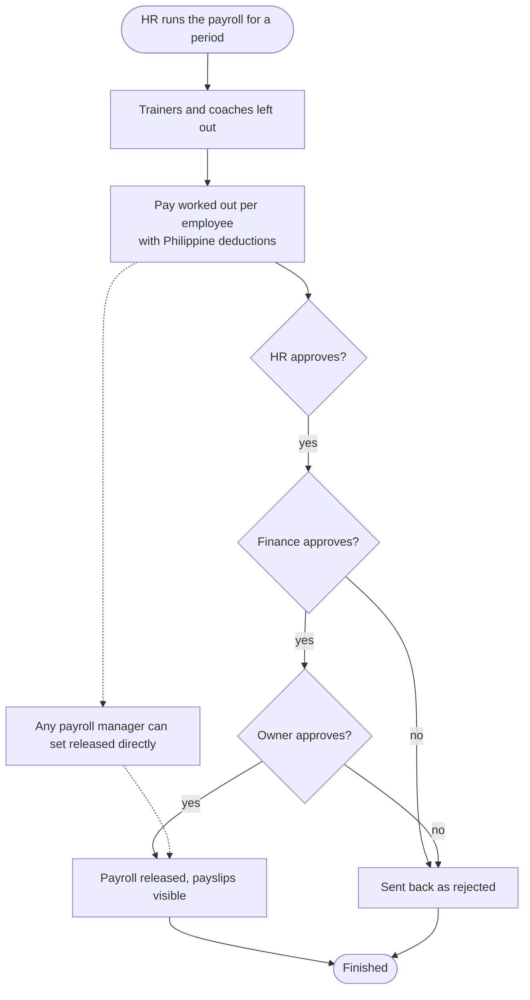

**Reading this:**

1. **Coaches dropped.** HR runs payroll for a period. Trainers and coaches are dropped straight away (`backend/app/Http/Controllers/API/PayrollController.php`, lines 389 to 392).
2. **Working out pay.** Pay is worked out with SSS, PhilHealth, Pag-IBIG and tax deductions (lines 1339 to 1535).
3. **The approval chain.** It then needs HR, finance and owner approval in turn (lines 594 to 894).
4. **The shortcut.** The dotted line shows a back door: a plain edit can set a payroll straight to "released" (lines 133 to 145).

## 7. The life story of a gym application, spec

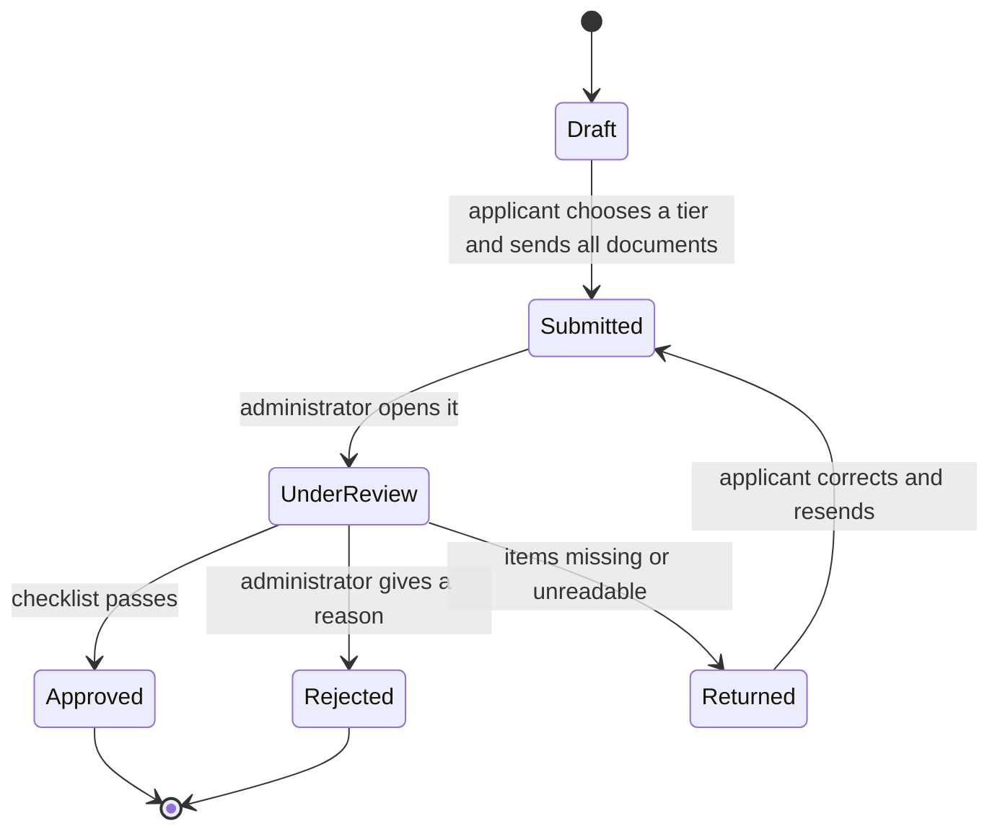

**Reading this:**

1. **Draft.** The applicant builds the application, chooses a tier and uploads that tier's documents (the spec, page 10).
2. **Under review.** Once sent, the administrator reviews it against the checklist (the spec, page 11).
3. **Three endings.**
   - *Approved*: the gym becomes visible with its tier badge.
   - *Rejected*: the decision is final and comes with a reason.
   - *Returned*: the applicant fixes the problems and sends it again (the spec, pages 10 and 11).

The applicant is notified of the decision (the spec, page 18). The state names "Draft" and "UnderReview" are *drawn from* the spec, page 10: "the system records the application status and lets the applicant review what has been submitted".

## 8. The life story of a membership, spec

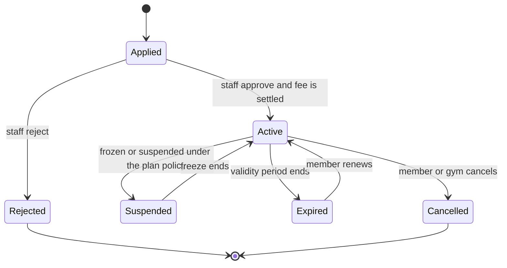

**Reading this:**

1. **Applying.** A platform user applies. Staff approve or reject (the spec, page 15).
2. **Active.** An approved membership is active until its validity ends. Reminders go out before it expires (the spec, pages 15 and 18).
3. **Changes while active.** It can be frozen under the plan's policy (the spec, page 12), renewed after it expires, or cancelled.

"Fee is settled" is *drawn from* the spec, page 12 (one all-inclusive fee) and page 16 (membership fees are income). Whether approval must wait for payment is not stated. The rebuild should decide it, and it is part of R-33 in [PHASE 4](../05%20-%20ROADMAP/phase-4/PHASE%204.md).

## 9. The life story of a booking, spec

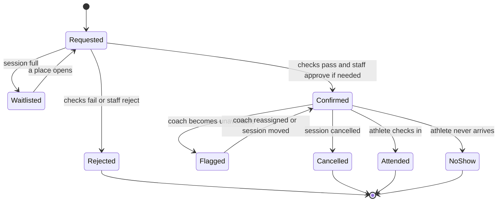

**Reading this:**

1. **Requested.** A booking starts as a request. If the session is full, it waits on the list until a place opens (the spec, page 13).
2. **Confirmed or rejected.** It is confirmed when the checks pass and, if the gym requires it, a staff member approves (the spec, page 14).
3. **Flagged.** If the coach becomes unavailable, the booking is flagged until staff reassign the coach or move the session (the spec, page 13).
4. **How it ends.** Attended, a no-show, cancelled or rejected (the spec, page 14).

Whether an athlete may cancel their own booking is open: Q-24 in the [open questions](../00%20-%20START%20HERE/00%20-%20START%20HERE.md).

## 10. The order of the phases

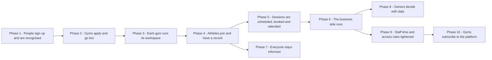

**Reading this:** An arrow means the phase it points at cannot start until the phase behind it is done.

- **Phases 1 to 6 run in a line.** Each needs the one before it. Gyms need accounts. Workspaces need approved gyms. Members need a gym's plans. Bookings need members and coaches. Payroll and income need attendance and bookings.
- **Phase 7 can start once Phase 4 is done,** alongside Phases 5 and 6. Its individual items still wait for the specific parts they announce or remind about.
- **Phase 8 reports on everything** in the first six phases.
- **Phase 9 needs only Phase 6,** because it adjusts staff attendance and payroll. It was added after Phase 8 was finished.
- **Phase 10 follows Phase 9,** because it reuses Phase 9's sidebar rule to hide locked modules. It also needs approved gyms (Phase 2) and PayMongo (Phase 4), both done long before.

This matches *The phases* in [05 - ROADMAP](../05%20-%20ROADMAP/05%20-%20ROADMAP.md), and the notes in `05 - ROADMAP/phase-1/PHASE 1.md` to `phase-10/PHASE 10.md`.

## 11. The proposed arrangement

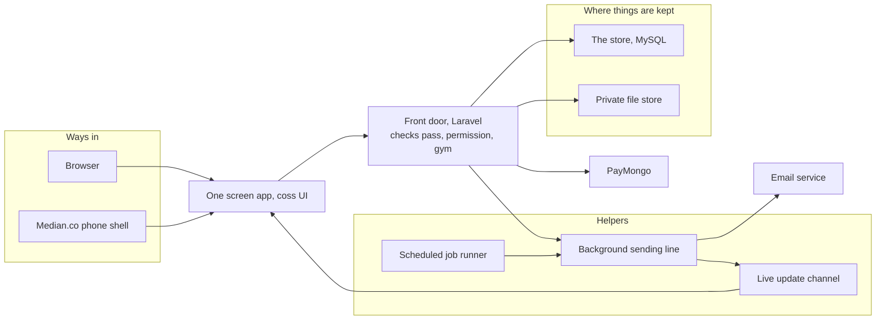

**Reading this:**

1. **Ways in.** People reach one screen app, from a browser or the Median.co phone shell. The app is built from coss UI parts (said in conversation, 3 November 2026).
2. **The front door.** Every request goes through one Laravel front door. It checks the sign-in pass, the person's permission for that module and their gym before doing anything. This fixes C-08, C-16 and C-18 in [02 - FINDINGS](../02%20-%20FINDINGS/02%20-%20FINDINGS.md).
3. **Storage.** Records go to MySQL. Private files go to a store nobody can reach without permission, which fixes the public-folder fault.
4. **Notices.** Anything that should tell people something goes to the background sending line. The line sends emails and pushes live updates back to open screens (C-20).
5. **Timed reminders.** The scheduled runner adds reminders on its own timetable.
6. **Payments.** Online payments go through PayMongo.

This matches *The arrangement being proposed* in [03 - SYSTEM ARCHITECTURE](../03%20-%20SYSTEM%20ARCHITECTURE/03%20-%20SYSTEM%20ARCHITECTURE.md).

## 12. The life story of a gym subscription, planned

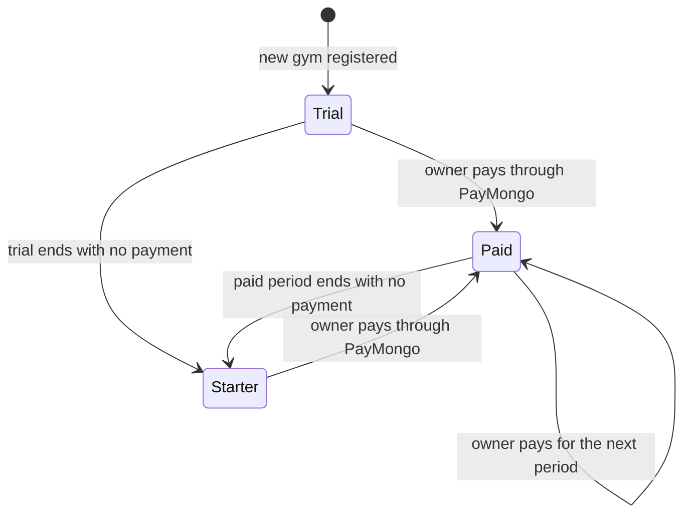

**Reading this:**

1. **Trial.** A new gym starts on a free trial. The administrator sets its length; it starts at 30 days (said in conversation, 9 November 2026). It opens every module and starts at approval (Q-25, Q-26).
2. **Paid.** The owner picks a paid plan, such as Pro or Elite, and pays through PayMongo. The plan starts only when the payment is confirmed (R-105).
3. **Starter.** A gym whose trial or paid period ends without payment moves to the free plan, Starter. It keeps only the modules Starter includes; its records are kept, and the rest unlock when it pays (R-106). There are no extra days after a paid month (Q-27).

This matches [PHASE 10](../05%20-%20ROADMAP/phase-10/PHASE%2010.md) and the subscription row in *The arrangement being proposed* in [03 - SYSTEM ARCHITECTURE](../03%20-%20SYSTEM%20ARCHITECTURE/03%20-%20SYSTEM%20ARCHITECTURE.md).

## 13. An offer from draft to discount, built

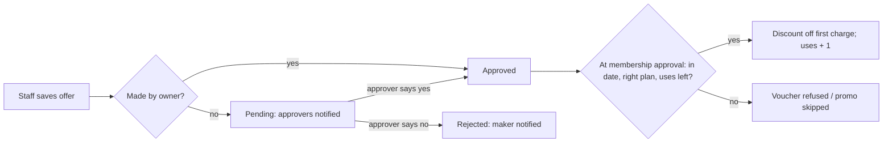

**Reading this:** a staff offer never works until someone else approves it (R-111). Editing an approved offer as staff sends it back to pending. Renewals never get the discount.

## 14. A coach application, built

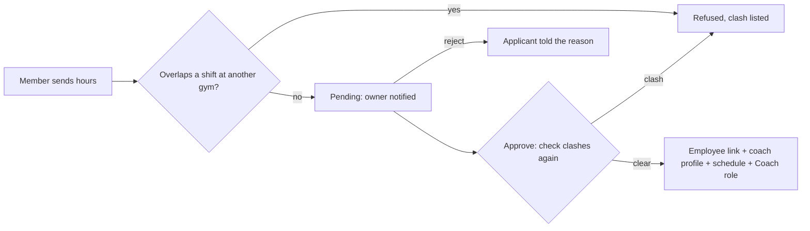

**Reading this:** the clash check runs when applying and again when approving, because schedules change (R-117). The account stays a member account.

## 15. The daily inactivity check, built

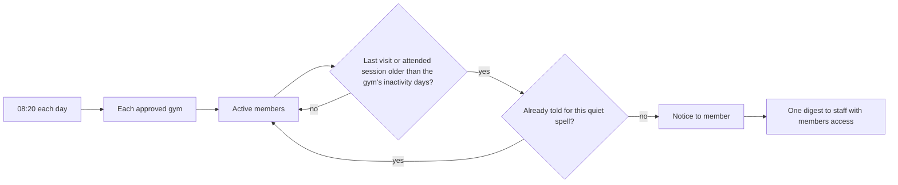

**Reading this:** notices only; nothing is blocked (R-116). A new visit starts a new quiet spell, which can be told once more.
